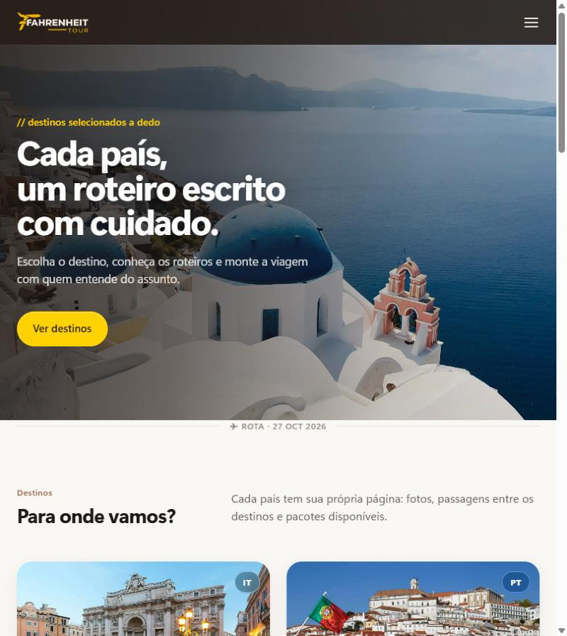
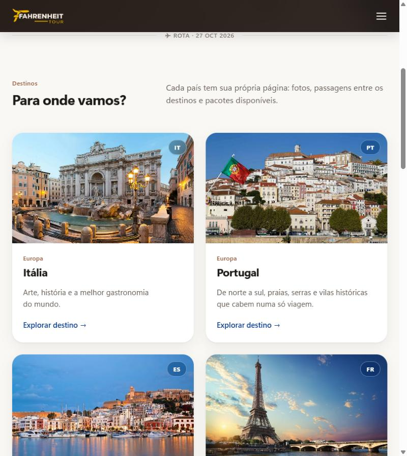
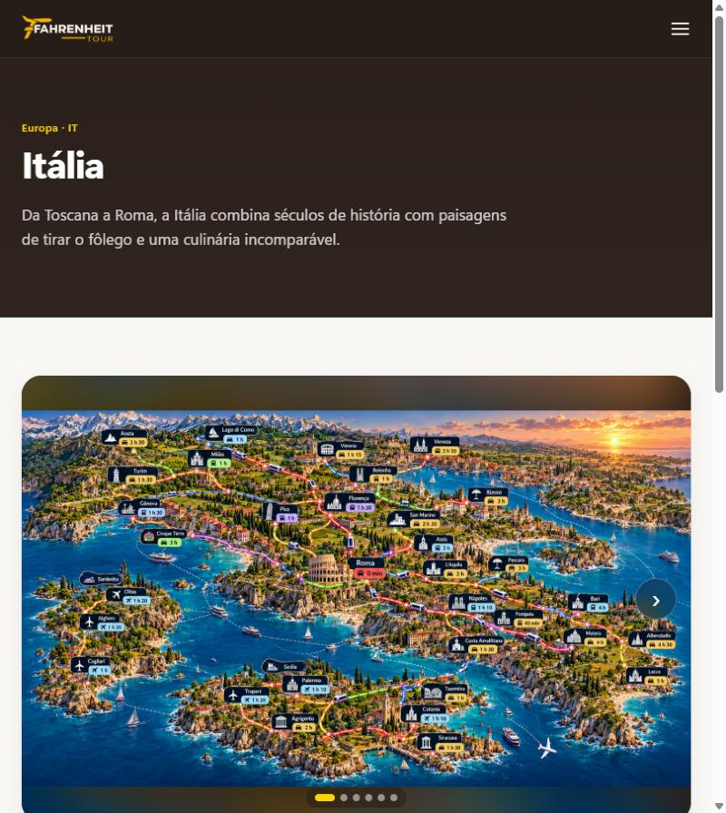

  

<h1 align="center">Fahrenheit Tour — Site + Painel Administrativo</h1>

  Site institucional e sistema de gestão para uma agência de viagens. 
  <a href="https://fahrenheitour.com.br"><strong>🌐 Ver o site no ar</strong></a>

  
  
  
  
  
  

> 🔒 **Projeto de cliente.** O código-fonte é privado. Este repositório apresenta o projeto, as funcionalidades e as decisões técnicas.

---

## O desafio

A agência precisava de um site próprio para apresentar seus destinos país por país e receber pedidos de reserva on-line. A equipe também queria **atualizar todo o conteúdo sozinha**, sem depender de programador para cada novo destino, foto ou pacote.

## A solução

Um sistema completo em **PHP + MySQL**, feito sob medida e pensado para hospedagem compartilhada (cPanel), dividido em duas partes:

- **Site público:** vitrine dos destinos, com uma página por país, mapa de roteiros, passagens entre cidades e reserva de pacotes.
- **Painel administrativo:** onde a agência gerencia países, destinos, fotos, pacotes, clientes e reservas.

## 📸 Telas

| Página inicial | Destinos | Página do país |
|---|---|---|
|  |  |  |

## ✨ Funcionalidades

**Site público**
- Página exclusiva para cada país, com galeria de fotos e mapa ilustrado dos roteiros
- Mapa interativo dos destinos (Leaflet + OpenStreetMap), com pinos e rota entre as cidades
- Passagens entre destinos (aéreas, ônibus e trem), com tempo de viagem
- Cadastro e login de clientes, área "Meu perfil" e recuperação de senha por e-mail
- Fluxo de reserva de pacotes de viagem
- Seção de relatos de viagem enviados pelos clientes

**Painel administrativo**
- Dashboard com métricas gerais
- Cadastro de países, destinos, fotos, pacotes e conexões entre cidades
- Gestão de clientes e de reservas, com controle de status
- Moderação dos relatos de viagem
- Administradores com dois níveis de acesso (super admin e editor)
- Configurações do site editáveis pelo painel

## 🛠️ Decisões técnicas

- **PHP puro, sem framework e sem etapa de build:** roda em qualquer hospedagem compartilhada e facilita a manutenção pelo cliente.
- **PDO com prepared statements** em todas as consultas, contra SQL injection.
- **Proteção CSRF** nos formulários do painel e senhas com `password_hash`.
- **Pastas sensíveis bloqueadas por `.htaccess`** (configuração e includes).
- **Leaflet + OpenStreetMap:** mapas gratuitos, sem chave de API nem custo mensal.
- **E-mails transacionais via SMTP** (PHPMailer) para recuperação de senha.
- Banco relacional com 8 tabelas: administradores, clientes, países, destinos, fotos, pacotes, reservas e configurações.

## 📄 Documentação

O projeto acompanha documentação técnica em padrão ABNT, com 7 diagramas UML (classes, objetos, componentes, implantação, casos de uso, sequência e atividades) e uma análise de conformidade com a **LGPD**.

---

  Desenvolvido por <a href="https://github.com/RaphaSouza28"><strong>Raphael Azevedo</strong></a> · Enlace Services

